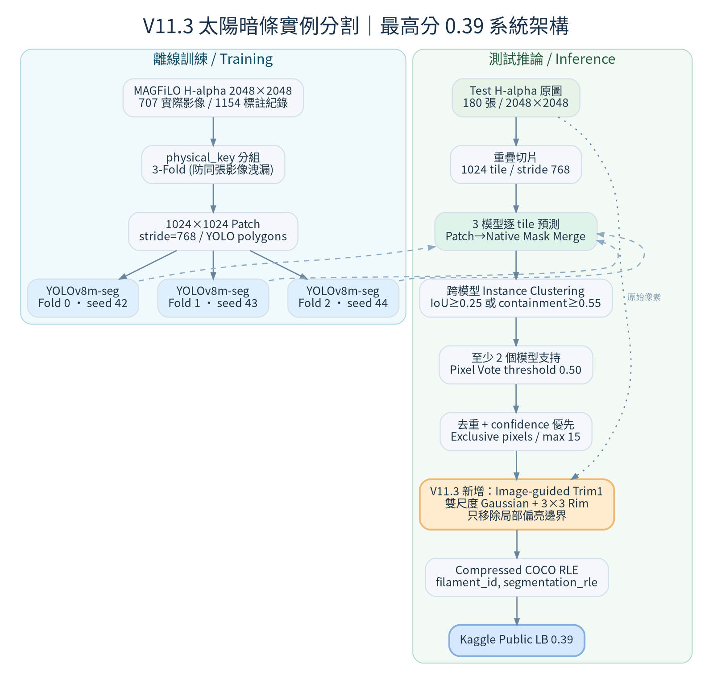

# Solar Filament Instance Segmentation — Kaggle 2026

This repository contains the training, inference, ensemble, and image-guided
mask-refinement pipeline used for the **Solar Filament Segmentation Challenge
2026**. The final submission achieved a **Kaggle Public Leaderboard score of
0.39**.



## Method overview

The system uses a three-fold YOLOv8m-seg ensemble followed by conservative
post-processing:

1. Split the 707 source images into three groups using `physical_key` to avoid
   leakage between related observations.
2. Extract overlapping `1024 x 1024` patches with a stride of 768 and convert
   the instance annotations to YOLO polygons.
3. Train three YOLOv8m-seg models using seeds 42, 43, and 44.
4. Run tiled inference and merge patch predictions in native `2048 x 2048`
   image coordinates.
5. Cluster instances across models using IoU and containment criteria, then
   retain instances supported by at least two models with a pixel-vote
   threshold of 0.50.
6. Resolve overlaps by confidence and limit each image to 15 instances.
7. Apply the V11.3 Trim1 refinement. This removes only locally bright outer
   boundary pixels identified by a dual-scale Gaussian response and never adds
   pixels to a predicted instance.
8. Encode the final masks as compressed COCO RLE.

## Repository layout

```text
code/
  solar_filament_v4/          Training, tiled inference, ensemble, and audit code
  v11_2_mask_refinement/      OOF refinement experiments
  v11_3_trim_submission/      Frozen Trim1 submission generator
docs/                         Architecture figure and technical notes
evidence/                     Screenshot of the 0.39 Kaggle submission
notebooks/                    End-to-end reproducibility walkthrough
reference/                    V4 ensemble submission used as Trim1 input
results/                      Final audit and OOF summaries
scripts/                      Reproduction and integrity-check helpers
source_environment/           Recorded training arguments and environment metadata
submission_v11_3_trim1.csv    Final audited Kaggle submission
```

The competition images, trained weights, and local virtual environment are not
included. Download the data through Kaggle under the competition rules and put
model weights in a local directory of your choice.

## Installation

Python 3.11 is recommended. Create a clean virtual environment instead of
committing `.venv` to the repository.

```bash
python -m venv .venv

# Linux/macOS
source .venv/bin/activate

# Windows PowerShell
# .\.venv\Scripts\Activate.ps1

python -m pip install --upgrade pip
pip install -r requirements.txt
```

Install a PyTorch build compatible with your CUDA driver if the pinned build in
`requirements.txt` is not available for your platform.

## Reproduce the final inference pipeline

The complete guided workflow is in
[`notebooks/V11_3_pipeline_walkthrough.ipynb`](notebooks/V11_3_pipeline_walkthrough.ipynb).
With the three trained checkpoints available, run:

```bash
bash scripts/run_final_pipeline.sh \
  /path/to/test/test_images \
  /path/to/fold0/best.pt \
  /path/to/fold1/best.pt \
  /path/to/fold2/best.pt
```

The script creates a V4 ensemble submission, applies the frozen Trim1 rule,
runs the submission audit, and prints SHA256 checksums. Its outputs are written
to `outputs/`.

To apply only Trim1 to an existing V4 ensemble:

```bash
python code/v11_3_trim_submission/make_trim1_submission.py \
  --submission reference/submission_v4_ensemble_LB038.csv \
  --test-dir /path/to/test/test_images \
  --output outputs/submission_v11_3_trim1.csv \
  --summary outputs/v11_3_trim1_audit.json \
  --per-image outputs/v11_3_trim1_images.csv
```

## Results and integrity checks

| Artifact | Result |
|---|---:|
| Kaggle Public Leaderboard | **0.39** |
| Output mask rows | 1,130 |
| Test images with predictions | 178 / 180 |
| Masks changed by Trim1 | 1,124 |
| Pixels removed | 168,390 / 2,677,672 (6.29%) |
| Output overlaps | 0 |

The two test images without predictions were also absent from the original V4
ensemble; they are not malformed or extra CSV rows. The final file included in
this repository has SHA256:

```text
13c19935e917018fe2a5c550927c2dc1fdf317987be4dba563e22e756d217f8f
```

Verify the included artifacts with:

```bash
python scripts/check_team_assets.py --project-root .
```

## Validation and limitations

The Trim1 rule improved pooled single-model out-of-fold PQ from 0.425718 to
0.429275 (+0.003557). This experiment evaluates refinement behavior, but it
does not prove that the same gain transfers to the three-model test ensemble.
The public leaderboard score is therefore reported separately from OOF PQ.

The main failure modes are low-contrast filaments, structures close to the
solar limb, and fragmented predictions spanning multiple tiles. Future work
could evaluate learned boundary refinement, stronger calibration across folds,
and multi-scale inference on a strictly held-out validation set.

## Citation

If this repository is useful, please cite the challenge dataset and the
software used by the pipeline. Bibliographic entries are provided in the
technical report draft in [`docs/ENGLISH_REPORT_DRAFT.md`](docs/ENGLISH_REPORT_DRAFT.md).

## Acknowledgment

The challenge uses GONG H-alpha observations and the MAGFiLO dataset. See the
competition page and final technical report for the complete acknowledgments
and data-use terms.
